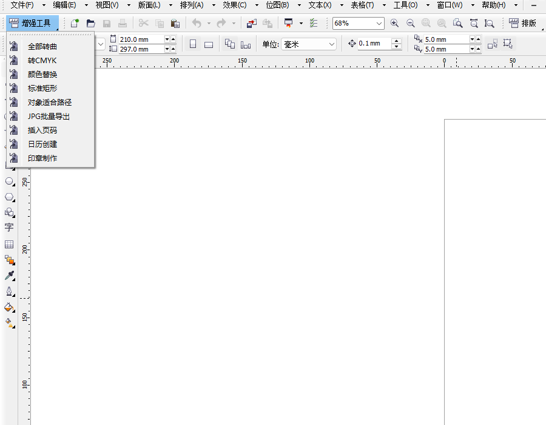
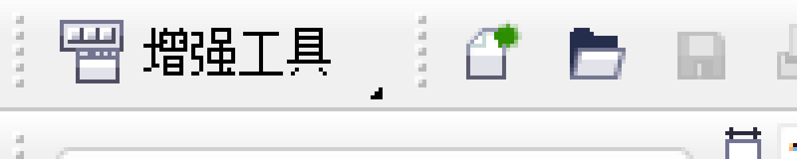

# CDR X4 增强工具包（CDRX4Toolkit）

**把 CorelDRAW X4 里 9 个高频排版 / 输出功能，收进一个「增强工具」图标 —— 点一下展开菜单，选中对象就能用。双击一个 `.vbs` 即可安装，可自由分发。**

`v1.3.0` · `CorelDRAW X4` · `VBA / GMS` · `MIT`

---

## 📸 界面预览

> 工具栏上只有一个「增强工具」按钮，点一下弹出 9 项菜单。打开 CorelDRAW 就在，无需手动配置。

---

## ✨ 功能一览

| # | 功能 | 用法 | 说明 |
|---|---|---|---|
| 1 | **全部转曲** | 直接点 | 弹窗两步：范围（全部 / 仅文字 / 仅图形）+ 是否深入 PowerClip 容器 |
| 2 | **转CMYK** | 直接点 | RGB 等填充 / 轮廓转 CMYK，可选给纯黑（`C0 M0 Y0 K100`）加叠印 |
| 3 | **颜色替换** | 先选中 **2 个**对象 | 第 1 个 = 原色，第 2 个 = 新色；点后会确认一次方向；全文档替换填充与轮廓 |
| 4 | **标准矩形** | 先选中矩形 | 把圆角 / 扇形角 / 倒棱角重置为直角 |
| 5 | **对象适合路径** | 选中 **1 条曲线 + 2 个对象** | 对象副本沿路径节点 / 线段均匀排布 |
| 6 | **JPG批量导出** | 直接点 | 按页导出 JPG，可设文件夹与 dpi |
| 7 | **插入页码** | 直接点 | 每页底部居中插入「第 X 页 / 共 Y 页」 |
| 8 | **日历创建** | 直接点 | 输入 `2026-09`，生成该月文字日历 |
| 9 | **印章制作** | 直接点 | 外圆 + 环形文字 + 五角星 + 下部文字 |

---

## 🚀 快速开始

### 安装

1. **先完全关闭 CorelDRAW X4**
2. 到 [**Release 页**](https://gitee.com/Ri1035/cdrx4-toolkit/releases) 下载 `安装CDRX4增强工具.vbs`，双击运行
3. 重新打开 CorelDRAW → 「增强工具」工具栏出现，点一下展开菜单即可使用

安装器只做两件事，**全程不碰运行中的 CorelDRAW**：

| 步骤 | 动作 |
|---|---|
| 1 | 把内嵌的 `CDRX4Toolkit.gms` 写进 `...\CorelDRAW Graphics Suite X4\User Draw\GMS\` |
| 2 | 把「增强工具」工具栏标记写进工作区 `DRAWUIConfig.xml`（改前自动备份为 `.cdrx4bak`） |

> 它只认 **X4 系列**目录，不会污染 2022 / 2024 等其它版本。

### 卸载

1. **先完全关闭 CorelDRAW**
2. 到 [**Release 页**](https://gitee.com/Ri1035/cdrx4-toolkit/releases) 下载 `卸载CDRX4增强工具.vbs`，双击运行
3. 它会删除 GMS，并把工具栏标记（**含展开按钮与 flyout 菜单栏**）从工作区清干净

> 检测到 CDR 还在运行会直接拒绝执行并提示；0 线程的崩溃僵尸不算「在运行」。

### 前提：必须有 VBA 组件

GMS 依赖 VBA。完整版 X4 自带；如果按 `Alt+F11` 打不开 VBA 编辑器，说明 VBA 被裁掉了，需要先补装。

---

## 🧭 版本与兼容性

| 项目 | 说明 |
|---|---|
| 当前版本 | **v1.3.0**（详见 [CHANGELOG.md](CHANGELOG.md)） |
| 适用版本 | **CorelDRAW X4（14.x）** |
| 不适用 | 2022 / 2024 等新版 —— 安装器只认 X4 目录，且 X4 编译的 GMS 需按版本重编 |
| 许可证 | [MIT](LICENSE) |

> **想在 2022 上用？** 可以移植（VBA 逻辑约 70–85% 可复用），但需要重编 GMS、改安装路径，并重新适配工具栏配置与图标。详见 [PLAN.md](PLAN.md)。

---

## 🛠 技术要点

- **工具栏纯工作区 XML**：不使用 `CommandBars` API，避开 X4 上的崩溃路径（`CrlFrmWk.dll`，会留下 0 线程僵尸）。
- **一图标 + flyout**：主栏只有 1 个展开按钮（`bmpCol=0 bmpRow=1031`），9 项功能放在 `flyout="true"` 的菜单栏里。
- **卸载对称**：按 `flyoutBarRef` 反查并删除展开按钮，不留点不动的死按钮。
- **纯 ASCII 安装器**：`安装/卸载 .vbs` 保持 ASCII，中文文案在运行时解码，避免编码踩坑。

---

## 📚 文档

| 文档 | 内容 |
|---|---|
| [CHANGELOG.md](CHANGELOG.md) | 版本变更记录（当前 v1.3.0） |
| [PLAN.md](PLAN.md) | 开发计划、验证记录、踩坑复盘（改代码前建议先看） |
| [docs/](docs/) | 侦察与移植流程等辅助文档 |

---

## 🙏 参考与致谢

功能对标 CorelDRAW 插件市场的同类插件：ConverTo、ColorReplacer、RectangleFixer、FitObjects、CalendarWizard、公章插件。

> 上述插件均已加密、无法读取源码；本项目仅作**功能对标**，未引入其代码。

---

## 📄 License

[MIT](LICENSE) · 全部源码开放，可自行修改、打包、分发。

---

📝 文档修改记录

| 日期 | 修改内容 |
|---|---|
| 2026-10-28 | 重做 Gitee 版 README：界面预览、功能表、安装/卸载、兼容性说明 |
| 2026-10-08 | 工具栏改「一图标 + 展开菜单」；打磨转曲 / 转 CMYK / 颜色替换（v1.3.0） |
| 2026-10-05 | README 精简为项目介绍，补充 topics 标签 |

